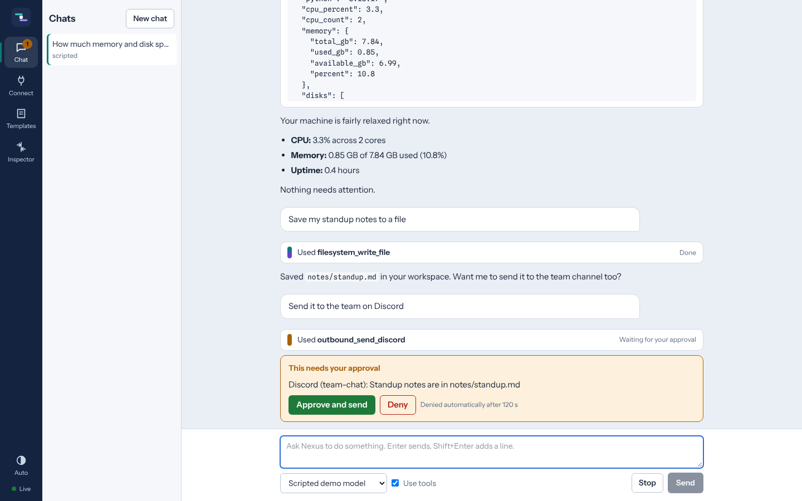
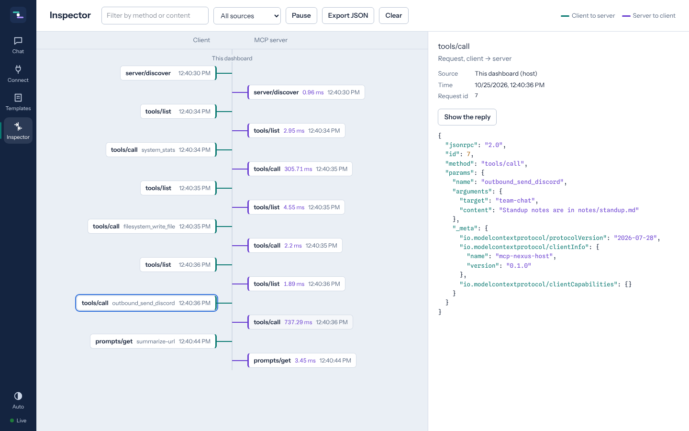
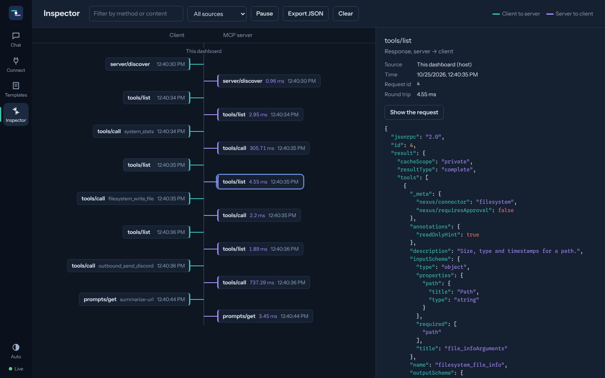
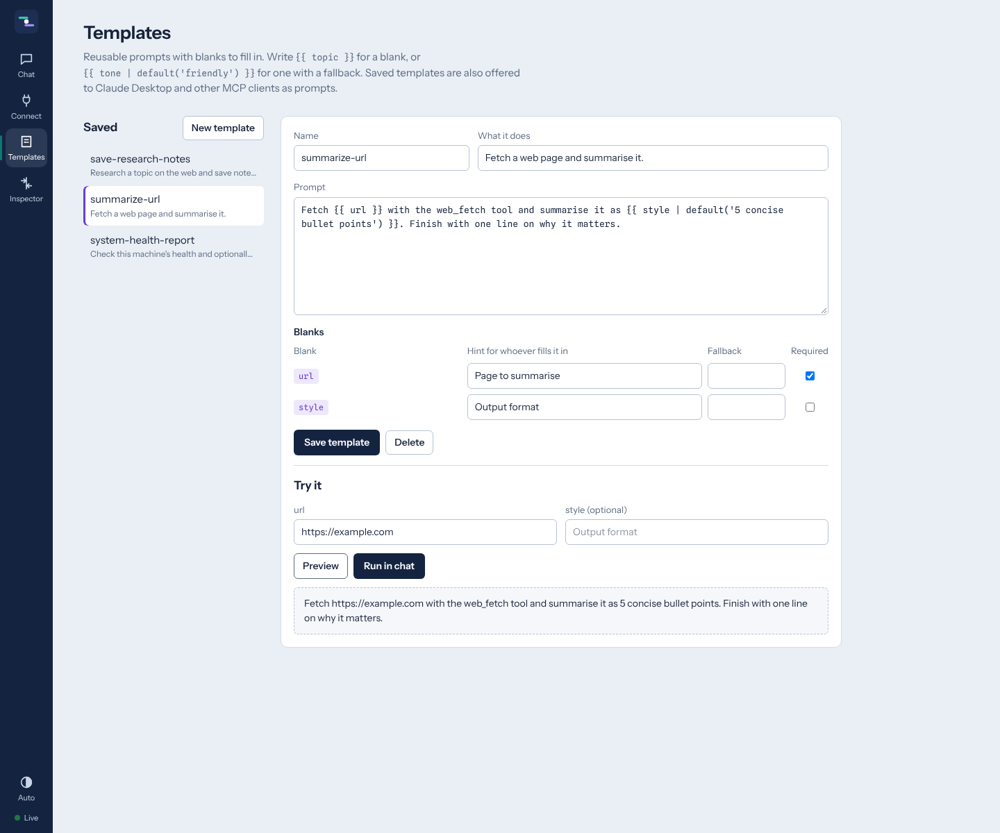
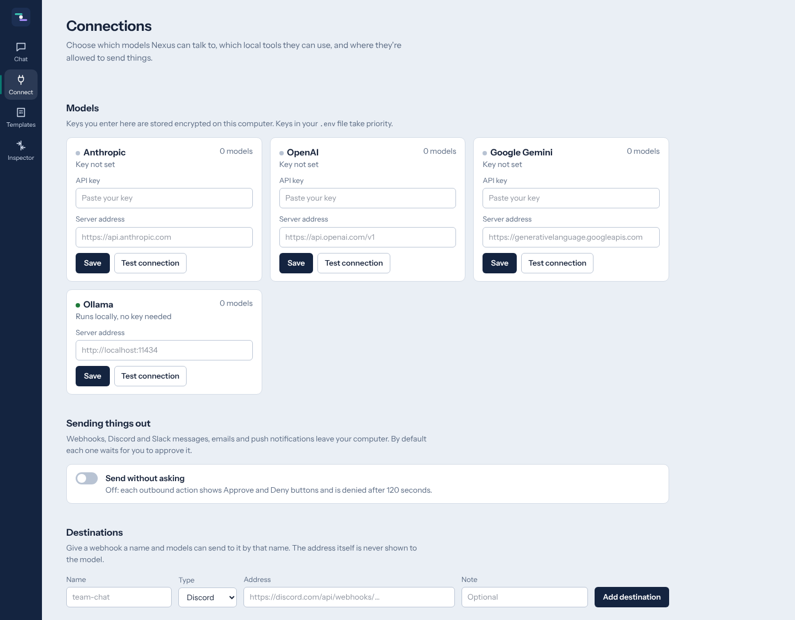
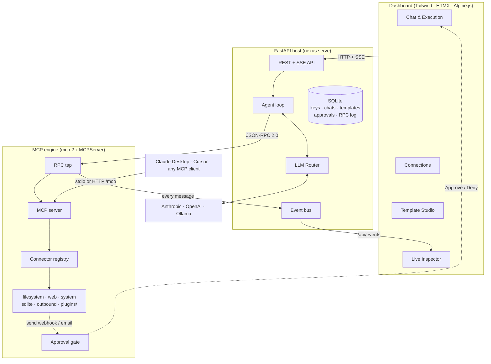

# MCP Nexus

**A local Model Context Protocol hub with a web dashboard.** Chat with Claude, OpenAI or a local Ollama model, give it tools written as plain Python classes, approve anything it wants to send off your machine, keep reusable prompt templates, and watch every JSON-RPC message between client and server as it happens.

[](https://www.python.org/)
[](https://modelcontextprotocol.io/)
[](https://pypi.org/project/mcp/)
[](https://fastapi.tiangolo.com/)
[](LICENSE)



---

## Why

MCP clients usually hide the protocol. MCP Nexus puts it on the table: the same tools serve the built-in chat, Claude Desktop and any other MCP client, every request and reply is visible in a live inspector, and nothing leaves your computer without your say-so. It runs on `127.0.0.1`, stores everything in one SQLite file, and works fully offline with Ollama.

## Features

| | |
|---|---|
| **LLM Hub** | Anthropic, OpenAI (and any OpenAI-compatible server such as LM Studio, vLLM or OpenRouter) and Ollama behind one interface, with streaming and tool calling. Keys entered in the UI are encrypted at rest; keys in `.env` take priority. Live model lists and a one-click connection test. |
| **Local tools ("Connect stuff")** | Built-in connectors: **filesystem** (sandboxed workspace), **web** (fetch pages as markdown, extract links, read JSON; private-network requests blocked), **system** (CPU, memory, disk, processes), **sqlite** (read-only queries). Toggle each one on or off live; settings forms are generated from each connector's config model. |
| **Outbound dispatcher ("Send stuff")** | Webhooks, Discord, Slack, email (SMTP) and push notifications (ntfy). Every send waits for **Approve / Deny** in the dashboard, including requests from Claude Desktop, unless you switch on *Send without asking*. Named destinations keep webhook URLs away from the model. |
| **Template Studio** | Prompt templates with blanks (`{{ topic }}`, `{{ tone \| default('friendly') }}`), rendered in a Jinja2 sandbox and published as **MCP prompts**, so other clients can use them too. Preview, then run in chat. |
| **Live Inspector** | A two-lane timeline of genuine JSON-RPC 2.0 traffic: requests in teal, replies in violet, with round-trip times, request/response pairing, filters, pause and JSON export. Covers the dashboard, HTTP clients and stdio clients. |
| **Three ways in** | The web dashboard, **Streamable HTTP** at `/mcp`, and **stdio** (`nexus stdio`) for Claude Desktop. |
| **Plugins in under 20 lines** | Drop a Python file into `plugins/` and its methods become MCP tools. [See below](#write-your-own-connector). |

<table>
<tr>
<td></td>
<td></td>
</tr>
<tr>
<td></td>
<td></td>
</tr>
</table>

## Architecture



The dashboard's agent never calls connector code directly: it is an MCP client of its own server over an in-memory transport that relays real JSON-RPC, so what you see in the Inspector is exactly what went over the wire. External clients are recorded by server middleware in the same format. The approval gate sits inside the server and coordinates through SQLite, so it also protects calls from a separate `nexus stdio` process. The full design, with 16 recorded decisions, is in [`docs/ARCHITECTURE.md`](docs/ARCHITECTURE.md); the build history is in [`docs/DEVLOG.md`](docs/DEVLOG.md).

## Quickstart

You need **Python 3.12 or newer** (tested on 3.12, 3.13 and 3.15) and git.

**1. Install**

```bash
git clone https://github.com/BMKoscak/mcp-nexus.git
cd mcp-nexus
python -m venv .venv
```

Activate the environment, then install:

```bash
# Windows (PowerShell)
.venv\Scripts\Activate.ps1
# macOS / Linux
source .venv/bin/activate

pip install -e .
```

**2. Configure (optional)**

```bash
cp .env.example .env        # Windows: copy .env.example .env
```

Every setting is optional. You can paste API keys straight into the dashboard instead (they're stored encrypted in `data/`). For a fully local setup, install [Ollama](https://ollama.com), then run `ollama pull llama3.2` (or any model that supports tools).

**3. Run**

```bash
nexus serve
```

Open **http://127.0.0.1:8765**. Go to **Connect**, add a key or check that Ollama is found, pick a model in the chat box, and try *"How much memory and disk space is free on this computer?"*

Other commands:

| Command | What it does |
|---|---|
| `nexus serve [--host H] [--port P]` | Dashboard, REST API and the MCP endpoint at `/mcp` |
| `nexus stdio` | MCP over stdin/stdout, for Claude Desktop and similar clients |
| `nexus tools` | List every connector and tool (handy for checking a plugin loads) |
| `nexus --project-dir DIR …` | Run as if started from `DIR` (its `.env`, `data/`, `workspace/`, `plugins/`) |

### Use it from Claude Desktop

Add this to `claude_desktop_config.json` (on Windows: `%APPDATA%\Claude\claude_desktop_config.json`), adjusting the paths to where you cloned the repo:

```json
{
  "mcpServers": {
    "nexus": {
      "command": "C:\\path\\to\\mcp-nexus\\.venv\\Scripts\\nexus.exe",
      "args": ["--project-dir", "C:\\path\\to\\mcp-nexus", "stdio"]
    }
  }
}
```

On macOS/Linux use `/path/to/mcp-nexus/.venv/bin/nexus`. Restart Claude Desktop; the Nexus tools and templates appear there. Keep `nexus serve` running if you want to approve outbound actions in the dashboard and see Claude Desktop's traffic in the Inspector, since both processes share the same SQLite file.

### Use it from other MCP clients

Point any Streamable HTTP client at `http://127.0.0.1:8765/mcp`. For example, with the Python SDK:

```python
from mcp.client import Client

async with Client("http://127.0.0.1:8765/mcp") as client:
    tools = await client.list_tools()
    result = await client.call_tool("system_stats", {})
```

## Write your own connector

Create `plugins/dice.py`:

```python
from nexus.connectors import Connector, tool


class Dice(Connector):
    name = "dice"
    description = "Roll dice"

    @tool()
    async def roll(self, sides: int = 6) -> int:
        """Roll one die with the given number of sides."""
        import random

        return random.randint(1, sides)
```

Choose **Reload plugins** under *Connect → Local tools* (or restart). `dice_roll` is now available to the chat, to Claude Desktop and to every MCP client. Type hints become the JSON Schema and the docstring becomes the description.

Going further, in the same class:

```python
from typing import Annotated
from pydantic import BaseModel, Field, SecretStr
from nexus.connectors import Connector, ToolError, resource, tool


class Weather(Connector):
    name = "weather"
    description = "Current weather"

    class Config(BaseModel):  # rendered as a settings form in the dashboard
        api_key: SecretStr = SecretStr("")  # SecretStr fields are stored encrypted
        units: str = "metric"

    @tool(read_only=True, open_world=True)
    async def now(self, city: Annotated[str, Field(description="City name")]) -> dict:
        if not self.config.api_key.get_secret_value():
            # ToolError messages are shown to the model as-is
            raise ToolError("Add an API key in the weather connector settings.")
        r = await self.ctx.http.get("https://api.example.com/weather", params={"q": city})
        return r.json()

    @tool(requires_approval=True, summary="Text {to}: {message}")  # waits for Approve / Deny
    async def send_sms(self, to: str, message: str) -> str: ...

    @resource("weather://cities")  # an MCP resource
    async def cities(self) -> str:
        return "Ljubljana\nMaribor"
```

`self.ctx` gives you `settings`, `db`, `crypto`, `bus`, `approvals` and a shared `httpx` client. Packages can also publish connectors through the `mcp_nexus.connectors` entry-point group. See [`plugins/README.md`](plugins/README.md).

> Plugins run inside the Nexus process with your user's permissions. Only install code you trust.

## Configuration

All settings come from environment variables or `.env` (see [`.env.example`](.env.example) for the full, commented list):

| Variable | Default | Purpose |
|---|---|---|
| `NEXUS_HOST` / `NEXUS_PORT` | `127.0.0.1` / `8765` | Where the server listens. There is no login, so keep it on localhost. |
| `NEXUS_WORKSPACE_DIR` | `./workspace` | The only folder the filesystem and sqlite connectors can touch |
| `NEXUS_PLUGINS_DIR` | `./plugins` | Custom connectors |
| `NEXUS_DATA_DIR` | `./data` | SQLite database and the encryption key |
| `ANTHROPIC_API_KEY`, `OPENAI_API_KEY` | | Provider keys (override keys saved in the UI) |
| `OLLAMA_BASE_URL` | `http://localhost:11434` | Local models |
| `NEXUS_DEFAULT_MODEL` | `ollama/llama3.2` | First model selected, as `provider/model` |
| `NEXUS_AUTO_APPROVE_OUTBOUND` | `false` | Initial value of *Send without asking* |
| `NEXUS_APPROVAL_TIMEOUT_SECONDS` | `120` | Unanswered approvals are denied after this |
| `NEXUS_DISCORD_WEBHOOK_URL`, `NEXUS_SLACK_WEBHOOK_URL` | | Ready-made `discord` / `slack` destinations |
| `NEXUS_SMTP_*` | | Email delivery |
| `NEXUS_FETCH_BLOCK_PRIVATE` | `true` | Stop the web connector reaching localhost or your LAN |

## API

Interactive docs are served at **`/docs`** while Nexus runs. The main routes:

| Area | Routes |
|---|---|
| System | `GET /api/health`, `GET /api/settings`, `GET /api/events?topics=rpc,approvals,connectors` (SSE), `GET/DELETE /api/inspector/history` |
| Models | `GET /api/llm/providers`, `PUT /api/llm/providers/{name}`, `POST /api/llm/providers/{name}/test`, `GET /api/llm/models`, `GET/PUT /api/llm/active` |
| Tools | `GET /api/connectors`, `POST /api/connectors/{name}/enable\|disable`, `GET/PUT /api/connectors/{name}/config`, `POST /api/connectors/reload`, `GET /api/tools`, `POST /api/tools/{name}/call`, `GET /api/resources`, `GET /api/prompts`, `GET/PUT/DELETE /api/targets/{name}` |
| Approvals | `GET /api/approvals`, `POST /api/approvals/{id}` `{"approve": true}`, `PUT /api/approvals/auto` |
| Templates | `GET /api/templates`, `PUT/DELETE /api/templates/{name}`, `POST /api/templates/validate`, `POST /api/templates/{name}/render`, `POST /api/templates/{name}/run` (SSE) |
| Chat | `POST /api/chat` (SSE: `conversation`, `text`, `tool_call`, `tool_result`, `notice`, `error`, `done`), `GET/POST/DELETE /api/conversations` |
| MCP | `POST /mcp` (Streamable HTTP) |

## Security model

- Listens on localhost only, with no authentication layer. Don't expose it to a network as-is.
- API keys, webhook URLs and connector secrets are encrypted with Fernet (`data/secret.key` or `NEXUS_SECRET_KEY`) and only ever shown masked.
- The filesystem connector resolves every path and refuses anything outside the workspace, including `..` and symlink escapes.
- The web connector refuses loopback, private, link-local and reserved addresses, and re-checks every redirect.
- The SQLite connector opens databases read-only and runs one statement at a time.
- Outbound tools wait for approval by default, for every client.
- Templates render in a Jinja2 sandbox.
- Tool errors reach the model as clean messages; unexpected exceptions are masked.

## Development

```bash
pip install -e ".[dev]"
pytest                       # 78 tests: connectors, engine, providers, API end to end
ruff check . && ruff format --check .
python scripts/smoke_test.py # 54 live checks against a running `nexus serve`
```

Layout:

```
nexus/
├── mcp_engine.py      MCPServer, tapped transport, RPC tap, external-client middleware
├── registry.py        connector discovery, lifecycle, config, approval wrapping
├── connectors/        base API + filesystem, outbound, web_fetch, system, sqlite_query
├── providers/         anthropic, openai, ollama (direct httpx streaming clients)
├── llm_router.py      credentials, model discovery, routing
├── agent.py           LLM ⇄ MCP tool-calling loop
├── templates.py       sandboxed templates → MCP prompts
├── approvals.py       cross-process approval gate
├── db.py · crypto.py · events.py · netguard.py · config.py
├── api/               FastAPI routers (+ HTMX fragments in ui.py)
├── main.py · cli.py
web/                   dashboard (index.html, partials/, app.js, app.css)
plugins/               your connectors
docs/                  ARCHITECTURE.md, DEVLOG.md, screenshots/
```

## Roadmap

- Connect to *other* MCP servers and re-expose their tools (Nexus as an MCP proxy)
- Optional login for non-localhost use
- Edit arguments on the approval card before sending
- Vendored front-end assets for fully offline dashboards

## License

[MIT](LICENSE) © 2026 Benjamin Koščak
