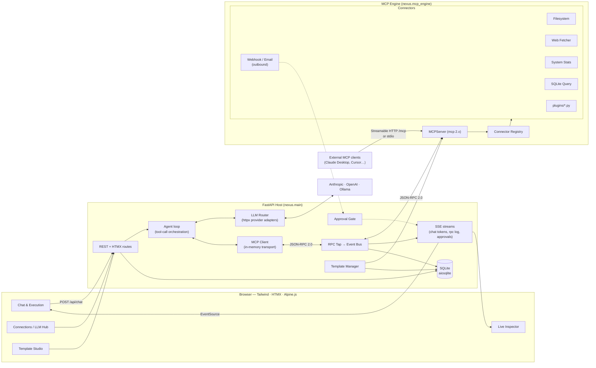
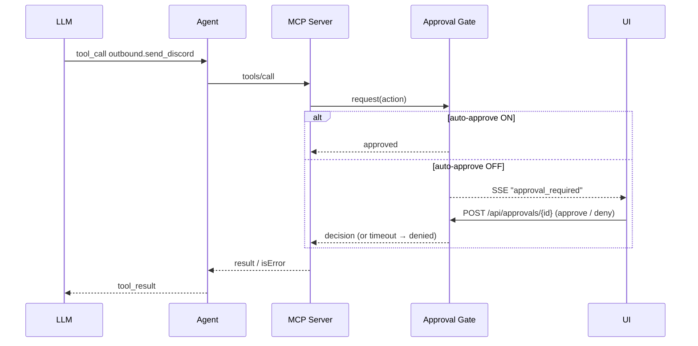

# MCP Nexus — Architecture

> Status: **Phase 2 implemented** (engine, persistence, connectors). Sections marked *(planned)* describe modules that later phases implement; this document is updated as they land.

## 1. Goals

| Goal | What it means in practice |
|---|---|
| **Local-first** | Runs on `127.0.0.1`, single process, SQLite on disk. Works fully offline with Ollama. |
| **Protocol-honest** | The host talks to tools *only* through real MCP JSON-RPC 2.0. This keeps the Inspector truthful and lets external MCP clients (Claude Desktop, Cursor, etc.) use the same tools. |
| **Pluggable** | A connector is one Python class. Drop it in `plugins/` and its tools appear without touching core code. |
| **Human in the loop** | Anything that sends data out of the machine (webhooks, email, notifications) can require approval in the UI. |
| **Zero-build frontend** | Jinja2 + Tailwind (CDN) + HTMX + Alpine.js. No Node toolchain. |

## 2. System overview



## 3. Module map

```
mcp-nexus/
├── nexus/
│   ├── config.py           Settings (env + .env), paths              [Phase 1 ✔]
│   ├── db.py               aiosqlite schema, migrations, repositories [Phase 2 ✔]
│   ├── crypto.py           Fernet encryption + masking for secrets     [Phase 2 ✔]
│   ├── events.py           In-process async pub/sub event bus          [Phase 2 ✔]
│   ├── approvals.py        Pending-action gate for outbound tools      [Phase 2 ✔]
│   ├── netguard.py         SSRF guard (blocks private/loopback IPs)    [Phase 2 ✔]
│   ├── mcp_engine.py       MCPServer + RPC tap + tapped transport      [Phase 2 ✔]
│   ├── registry.py         Connector discovery, lifecycle, config      [Phase 2 ✔]
│   ├── connectors/
│   │   ├── base.py         Connector base class + @tool/@resource      [Phase 2 ✔]
│   │   ├── filesystem.py   Sandboxed read/write/list/search            [Phase 2 ✔]
│   │   ├── outbound.py     Webhooks, Discord, Slack, email, ntfy push  [Phase 2 ✔]
│   │   ├── web_fetch.py    Fetch → markdown/text, links, JSON          [Phase 2 ✔]
│   │   ├── system.py       CPU/RAM/disk/process stats (psutil)         [Phase 2 ✔]
│   │   └── sqlite_query.py Read-only SQL against workspace DBs         [Phase 2 ✔]
│   ├── llm_router.py       Provider registry, model list, test conn    [Phase 3]
│   ├── providers/          anthropic.py · openai.py · ollama.py (httpx) [Phase 3]
│   ├── agent.py            LLM ⇄ MCP tool-calling loop                 [Phase 3]
│   ├── templates.py        Prompt template CRUD → MCP prompts          [Phase 3]
│   ├── api/                FastAPI routers (chat, llm, connectors, …)  [Phase 3]
│   ├── main.py             App factory, lifespan, mounts /mcp          [Phase 3]
│   └── cli.py              `nexus serve` / `nexus stdio`               [Phase 3]
├── web/templates, web/static   Dashboard (Jinja2 + HTMX + Alpine)      [Phase 4]
├── plugins/                User connectors, auto-discovered
├── tests/                  pytest (+ pytest-asyncio)
├── data/                   SQLite DB, secret.key (git-ignored)
└── workspace/              Filesystem connector sandbox (git-ignored)
```

## 4. Key components

### 4.1 MCP Engine *(Phase 2 ✔ — `nexus/mcp_engine.py`)*

- Built on **`mcp` 2.3**. In 2.x the former `FastMCP` class is `mcp.server.mcpserver.MCPServer`; it exposes `add_tool` / `remove_tool` / `add_prompt` / `add_resource`, which is what makes runtime (un)registration possible. The SDK negotiates the **`2026-07-28`** protocol revision (`server/discover` instead of the old `initialize` handshake) and falls back to legacy servers automatically.
- **Why a custom transport:** handed an in-process `MCPServer`, the 2.x `Client` uses a *direct dispatcher* with no JSON-RPC framing at all — there would be nothing real for the Inspector to show. `TappedTransport` instead runs the low-level server over two memory-stream pairs joined by relay tasks:

  ```
  host Client ⇄ client streams ⇄ relay (c2s/s2c, tapped) ⇄ server streams ⇄ MCPServer
  ```

  Each relay copies the `SessionMessage` to `RpcTap.record()` before forwarding it, so the log is the exact JSON-RPC the server sent and received.
- **Supervisor task:** the client session owns anyio task groups, which must be entered and exited in the same task. The engine runs the session in a dedicated `mcp-host-client` task and signals it to stop, so `start()`/`stop()` can be called from different tasks (FastAPI lifespan, pytest fixtures).
- The host client is created with `cache=None` because tools change at runtime and the SDK's response cache would otherwise serve stale `tools/list` results.
- **One server, three transports:**
  1. **In-memory** — the FastAPI host connects its own `Client` to the server over memory streams. This is the path the web UI uses.
  2. **Streamable HTTP** — `server.streamable_http_app()` is mounted at `/mcp` so external clients can connect to `http://127.0.0.1:8765/mcp`.
  3. **stdio** — `nexus stdio` runs the same server for Claude Desktop-style configs.
- **RPC Tap:** each message becomes an entry `{seq, ts, transport, session, direction: c2s|s2c, kind: request|response|notification|error, method, rpc_id, latency_ms, payload}`. Responses are paired with their request by `(session, direction, id)` to fill in `method` and `latency_ms`. Entries are published on the `rpc` bus topic immediately and written to `rpc_log` in 0.5 s batches (ring buffer, default 2,000 rows). HTTP-transport traffic will be tapped with ASGI middleware on `/mcp` in Phase 3.

### 4.2 Connector Registry *(Phase 2 ✔ — `nexus/registry.py`, `nexus/connectors/base.py`)*

A connector is a class; methods decorated with `@tool` become MCP tools and `@resource("uri")` become MCP resources. Type hints and the docstring/description produce the JSON Schema automatically (via the SDK's function introspection).

```python
from nexus.connectors import Connector, tool

class Dice(Connector):
    name = "dice"
    description = "Roll dice"

    @tool()
    async def roll(self, sides: int = 6) -> int:
        """Roll one die."""
        import random
        return random.randint(1, sides)
```

- **Discovery:** built-ins in `nexus/connectors/`, user files in `plugins/`, and the `mcp_nexus.connectors` entry-point group for pip-installed packages.
- **Naming:** tools are published as `<connector>_<tool>` → e.g. `filesystem_read_file`. Dots were ruled out because Anthropic and OpenAI both require tool names to match `^[A-Za-z0-9_-]{1,64}$`; the registry validates every name against that pattern.
- **Lifecycle:** enable/disable per connector is stored in `connector_state`; toggling calls `add_tool`/`remove_tool` and emits `notifications/tools/list_changed` so connected clients refresh.
- **Config:** a connector may declare a Pydantic `Config` model; `config_view()` returns its JSON Schema + current values for a UI form, and `update_config()` validates, persists and hot-restarts the connector. Fields typed `SecretStr` are stored Fernet-encrypted (`{"__enc__": token}`) and shown masked; posting the mask back leaves the secret unchanged.
- **Approval wrapping:** for `@tool(requires_approval=True)` the registry registers a `functools.wraps` wrapper that calls the approval gate first. `wraps` preserves the signature and annotations, so the generated JSON Schema is identical to the unwrapped method's.
- **Tool metadata:** every tool carries `_meta` `{"nexus/connector", "nexus/requiresApproval"}` and, where declared, MCP annotations (`readOnlyHint`, `destructiveHint`, `openWorldHint`) so the UI can badge tools.
- **Errors:** `ToolError("…")` messages reach the model verbatim; any other exception is masked by the SDK as a generic "Error executing tool" so internals don't leak.
- **Isolation of failures:** a plugin that fails to import is shown as *errored* in the UI with its traceback; it never prevents startup.

### 4.3 Outbound Dispatcher & Approval Gate *(Phase 2 ✔ — `nexus/approvals.py`, `nexus/connectors/outbound.py`)*

Outbound tools (`outbound_send_webhook`, `outbound_send_discord`, `outbound_send_slack`, `outbound_send_email`, `outbound_notify` via ntfy) are marked `requires_approval=True`; `outbound_list_targets` is read-only.



- The gate is an `asyncio.Future` per pending action, persisted in `pending_actions` for audit (`approved`, `denied`, `timeout`, `auto`). The auto-approve toggle is stored in `settings` so it survives restarts; `NEXUS_AUTO_APPROVE_OUTBOUND` is only the initial default.
- Approval cards show a human summary rendered from the tool's `summary=` template (e.g. `Discord (team): hello`) plus the arguments. Editing arguments before approving was considered and deferred: edited values would bypass the SDK's argument validation.
- Named targets (`discord`, `slack`, saved custom webhooks) resolve server-side so the LLM never sees webhook URLs.
- External MCP clients hit the same gate: their calls wait for approval in the Nexus UI (or time out).

### 4.4 LLM Router *(planned — Phase 3)*

- **Direct async clients over `httpx`** — one small adapter per provider behind a common `Provider` protocol:
  - `AnthropicProvider` → `POST /v1/messages` (SSE stream, `tool_use` / `tool_result` blocks)
  - `OpenAIProvider` → `POST /v1/chat/completions` (SSE stream, `tool_calls`); also works for any OpenAI-compatible endpoint (LM Studio, vLLM, OpenRouter) via a custom base URL
  - `OllamaProvider` → `POST /api/chat` (NDJSON stream, native `tools`)
- Each adapter normalises into one internal shape: `TextDelta`, `ToolCall(id, name, arguments)`, `Done(usage, stop_reason)`. The agent loop only sees that shape.
- Models are addressed as `<provider>/<model>` (e.g. `anthropic/claude-sonnet-5-5`, `ollama/llama3.2`).
- Provider credentials resolve in order: environment → encrypted SQLite (`providers` table) → none.
- `GET /api/llm/models` merges a curated list for cloud providers with a live `GET {OLLAMA_BASE_URL}/api/tags` for local models.
- "Test connection" sends a 1-token completion and reports latency or the provider's error.

### 4.5 Agent loop *(planned — Phase 3)*

1. `client.list_tools()` → convert each MCP tool's `inputSchema` to an OpenAI function spec.
2. Stream the completion; forward text deltas to the browser over SSE.
3. On tool calls, execute each via `client.call_tool()` (through the tap, so it shows in the Inspector), append results, and loop — capped by `max_steps` (default 8).
4. Persist the conversation (`conversations`, `messages`).

### 4.6 Template Studio *(planned — Phase 3)*

- Templates are stored in SQLite with a name, description, body and a declared argument list (name, description, required, default).
- Bodies use `{{ variable }}` syntax rendered with Jinja2's **`SandboxedEnvironment`** (no attribute access to Python internals).
- Each template is registered as an **MCP Prompt**, so `prompts/list` and `prompts/get` work for external clients too. "Run" in the UI renders the prompt via `prompts/get` and sends it to the selected model.

### 4.7 Live Inspector *(planned — Phase 4)*

- Event bus topic `rpc` → `GET /api/inspector/stream` (SSE).
- UI shows a two-column timeline (client → server / server → client), pairs requests with responses by `id`, shows latency, and highlights errors; filter by method; pause; export JSON.
- Last N messages (default 2,000) are kept in `rpc_log` so a page reload keeps history.

## 5. Data model (SQLite) *(Phase 2 ✔ — `nexus/db.py`)*

| Table | Purpose |
|---|---|
| `settings` | Key/value runtime settings (e.g. `auto_approve_outbound`, `active_model`) |
| `providers` | Provider name, base URL, **encrypted** API key, enabled flag |
| `connector_state` | Connector name, enabled flag, JSON config |
| `webhook_targets` | Named custom webhook destinations (URL encrypted) |
| `templates` | Prompt templates + JSON argument schema |
| `conversations` / `messages` | Chat history incl. tool calls/results |
| `rpc_log` | Ring buffer of tapped JSON-RPC messages |
| `pending_actions` | Approval audit trail (payload, decision, decided_at) |

Schema versioning uses `PRAGMA user_version` with ordered migration functions; WAL mode is enabled for concurrent reads during streaming.

## 6. Security model

- **Bind to localhost** by default. No auth layer in v1, so exposing it on a network is explicitly unsupported.
- **Secrets:** UI-entered keys are encrypted with Fernet (`NEXUS_SECRET_KEY` or an auto-generated `data/secret.key`), never returned to the browser in full (masked `sk-…abcd`).
- **Filesystem sandbox:** all paths resolved with `Path.resolve()` and required to be inside `NEXUS_WORKSPACE_DIR`; symlink escapes rejected; size limits on read/write.
- **Web fetcher SSRF guard:** resolves the hostname and refuses loopback/private/link-local/reserved ranges (incl. IPv4-mapped IPv6) unless `NEXUS_FETCH_BLOCK_PRIVATE=false`; redirects are followed manually and every hop is re-checked; response size and time capped. Known limitation: a DNS-rebinding attacker could change the answer between the check and httpx's own lookup.
- **Outbound webhooks are *not* SSRF-filtered** — posting to a local n8n/Home Assistant is a legitimate use — but they are approval-gated, and raw URLs can be disabled in favour of named targets.
- **SQLite query tool:** only files inside the workspace (or an explicit allow-list) are reachable; opened with `mode=ro` URIs plus `PRAGMA query_only`; the driver rejects multi-statement strings; row cap.
- **Outbound approval** on by default (see 4.3).
- **Template rendering** in a Jinja2 sandbox.
- **Plugins are trusted code** — they run in-process with full privileges. The README says so plainly.

## 7. Key decisions (ADR log)

| # | Decision | Alternatives considered | Why |
|---|---|---|---|
| 1 | Host uses the MCP **client** over in-memory transport to reach its own tools | Call connector functions directly | Keeps one code path for internal and external clients and makes the Inspector show genuine JSON-RPC. Small overhead is irrelevant locally. |
| 2 | **mcp 2.x `MCPServer`** | Pin `mcp<2` and use `FastMCP` | 2.x is current; `add_tool`/`remove_tool` cover dynamic registration. |
| 3 | **Direct `httpx` adapters** for Anthropic / OpenAI / Ollama | LiteLLM; official vendor SDKs | LiteLLM (1.106) declares `Requires-Python <3.15`, so it cannot install on Python 3.15, and it is a very large dependency. The three APIs are small and stable; ~100 lines per adapter gives full control over streaming and tool calls, and the protocol makes adding providers easy. Trade-off: we maintain the adapters. |
| 4 | **SSE** over WebSockets | WebSockets | All real-time flows are server → browser; SSE works with HTMX's `sse` extension and plain `EventSource`, survives proxies, auto-reconnects. Browser → server stays plain POST. |
| 5 | **SQLite + aiosqlite**, no ORM | SQLAlchemy | Handful of tables; raw SQL with Pydantic models keeps it small and transparent. |
| 6 | Tailwind/HTMX/Alpine **via CDN** | Vite build | Zero-build requirement; versions pinned in URLs. Trade-off: needs internet on first page load for CDN assets (can be vendored later). |
| 7 | Approval gate inside the **server** (not the agent) | Gate only in the chat agent | Ensures external MCP clients can't bypass approval for outbound actions. |
| 8 | Custom **`TappedTransport`** for the host client | SDK's in-process `Client(server)` | The SDK's in-process path skips JSON-RPC entirely (direct dispatcher), so there would be nothing genuine to inspect. |
| 9 | Tool names `connector_tool` | `connector.tool` | Anthropic and OpenAI reject dots in tool names. |
| 10 | **selectolax `lexbor`** backend for HTML | BeautifulSoup, readability libs | Fast C parser with no extra deps; selectolax 1.0 removed the old `modest` backend. |
